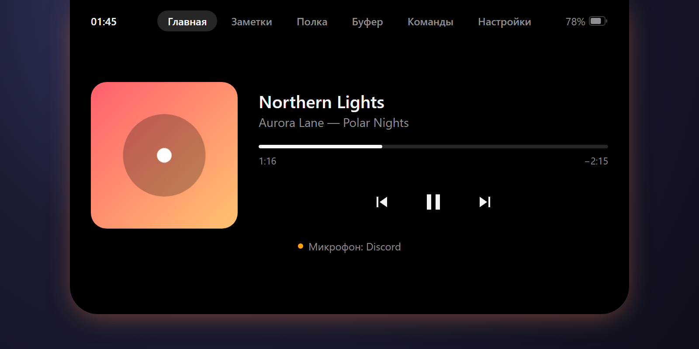
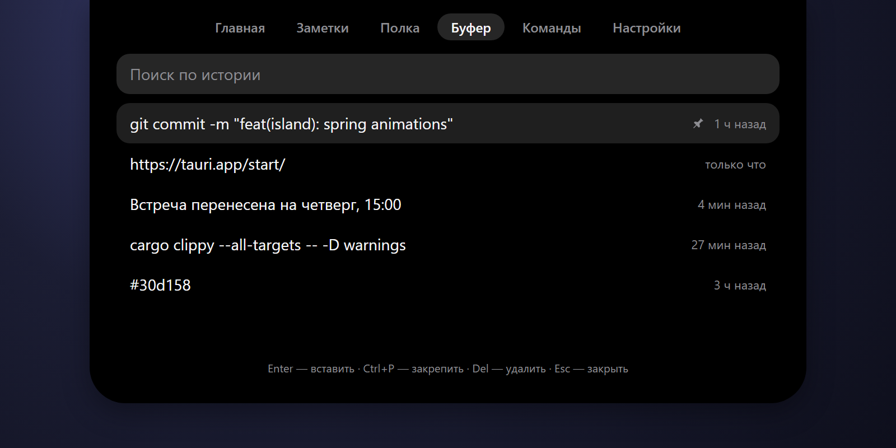
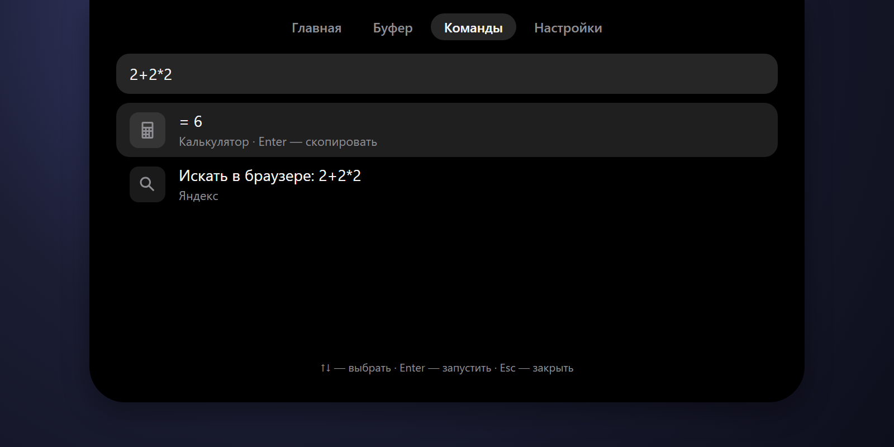
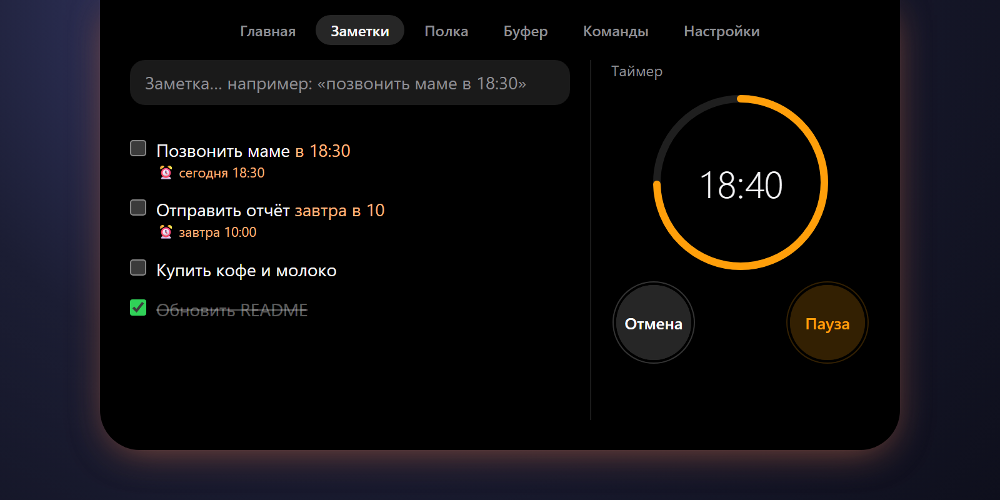
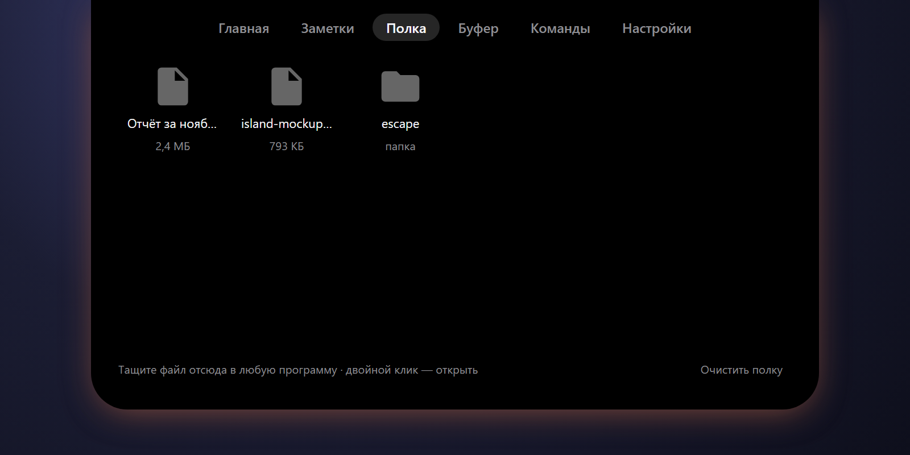
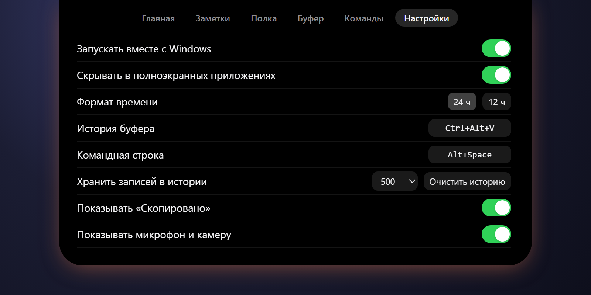

# Escape

**Dynamic Island для Windows.** Компактная «пилюля» по центру верхнего края экрана
показывает живые события — музыку, время, заряд, — а при наведении раскрывается в панель
с плеером, историей буфера обмена и командной строкой.

<!-- Demo GIF: record with ScreenToGif and save as docs/demo.gif -->
<!--  -->

|                      Пилюля                      |                       Музыка                        |                    Смена трека                     |
| :----------------------------------------------: | :-------------------------------------------------: | :------------------------------------------------: |
|  |  |  |



|               История буфера (Ctrl+Alt+V)                |            Командная строка (Alt+Space)            |
| :------------------------------------------------------: | :------------------------------------------------: |
|  |  |







## Возможности

- **Остров, который не мешает.** Клики проходят сквозь пустые области, фокус не
  отнимается, в полноэкранных играх и видео остров прячется. Раскрывается при наведении
  или упоре курсора в верхний край; пружинные анимации.
- **Музыка из любого плеера**, который видит Windows (Spotify, Яндекс Музыка, YouTube в
  браузере): обложка, эквалайзер, прогресс, кнопки, подсветка цветом обложки.
- **История буфера обмена** — текст и картинки, поиск, закрепление, вставка в окно,
  откуда вы её открыли. Пароли из менеджеров паролей не сохраняются.
- **Командная строка** — программы и приложения Store, калькулятор (`2+2*2`), поиск в
  Яндексе, блокировка компьютера.
- **Полка файлов** — перетащите файлы на остров, и они подождут там; оттуда их можно утащить
  в любую программу (после этого они уходят с полки). Полка хранит ссылки, а не копии.
- **Заметки с напоминаниями и таймер** — время пишется прямо в заметке («позвонить маме
  в 18:30», «чай через 15 мин», «отчёт завтра в 9»); в срок остров покажет её со звуком и
  не уберёт, пока вы не отреагируете. Таймер как на iPhone: барабаны, кольцо отсчёта, а в
  пилюле — значок и оставшееся время; по окончании звенит, пока вы не отреагируете.
- **Микрофон, камера и Caps Lock** — как на iPhone: оранжевая точка в пилюле, пока
  микрофон занят, зелёная — камера; на главной видно, какое приложение их держит. Переключение
  Caps Lock коротко показывается в острове. Оба индикатора отключаются в настройках.
- **Статус Claude Code** — значок в пилюле, пока Claude работает, и всплывающее «Claude
  ждёт вас», когда нужен ваш ответ. Подключается кнопкой в настройках: Escape добавляет
  свои хуки в `~/.claude/settings.json` (с резервной копией) и принимает их события только
  на `127.0.0.1`.
- **Настройки** прямо в острове: монитор, автозапуск, горячие клавиши, формат времени,
  размер истории, прозрачность. Иконка в трее, автообновления.

Всё хранится только на вашем компьютере. Единственный сетевой запрос — проверка
обновлений (и поиск в браузере, когда вы сами его запускаете).

## Горячие клавиши

| Клавиши          | Действие                                          |
| ---------------- | ------------------------------------------------- |
| `Ctrl+Alt+V`     | История буфера обмена                             |
| `Alt+Space`      | Командная строка (если занята — `Ctrl+Alt+Space`) |
| `↑` `↓` `Enter`  | Выбрать и вставить / запустить                    |
| `Ctrl+P` / `Del` | Закрепить / удалить запись истории                |
| `Esc`            | Свернуть остров и вернуть фокус                   |

Сочетания меняются в настройках.

## Стек

Tauri 2 (WebView2) · Rust (`windows` crate: Win32 + WinRT) · React 19 + TypeScript ·
Vite · Tailwind CSS v4 · motion · zustand · SQLite (rusqlite).

Архитектура и решения — в [PLAN.md](PLAN.md), выпуск релизов — в
[docs/RELEASING.md](docs/RELEASING.md).

## Как запустить

### Требования

- Windows 10 22H2+ или Windows 11
- [Rust](https://rustup.rs/) (toolchain `stable-x86_64-pc-windows-msvc`)
- [Visual Studio Build Tools](https://visualstudio.microsoft.com/visual-cpp-build-tools/)
  с компонентом «Desktop development with C++»
- Node.js 20+
- WebView2 Runtime (в Windows 11 уже есть)

### Разработка

```bash
npm install
npm run tauri dev
```

Демо-сцены для скриншотов (только в dev): `http://localhost:1420/?demo=home` — также
`compact`, `music`, `peek`, `clipboard`, `launcher`, `settings`.

### Сборка установщика

```bash
npm run tauri build -- --config src-tauri/tauri.ci.conf.json
```

Установщик NSIS появится в `src-tauri/target/release/bundle/nsis/`. Подписанная сборка
для автообновлений описана в [docs/RELEASING.md](docs/RELEASING.md).

### Проверки

```bash
npm run lint && npm run typecheck && npm test
cd src-tauri && cargo fmt --check && cargo clippy --all-targets -- -D warnings && cargo test
```

## Лицензия

[MIT](LICENSE)
